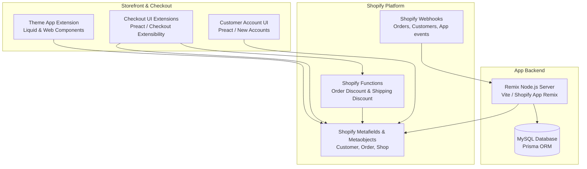
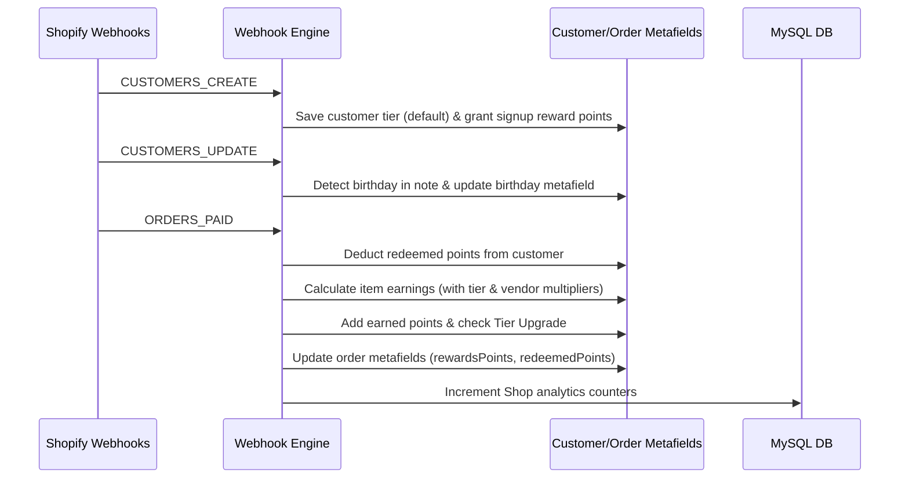

#  Loyalty & Discounts — Feature & Implementation Specification

## 1. Executive Summary

** Loyalty & Discounts** is a full-featured, enterprise-grade Shopify loyalty, rewards, and VIP tier platform built for **Shopify Extensibility**. It utilizes **Shopify Functions (WASM)** for fast, native discount calculations, **Checkout UI Extensions** for seamless point redemption inside the checkout, **Customer Account UI Extensions** for New Customer Accounts, and **Theme App Extensions** for Online Store 2.0 storefronts.

---

## 2. System Architecture & Tech Stack

### Technology Highlights
- **App Framework**: Remix v2 + Vite, `@shopify/shopify-app-remix`
- **Database / ORM**: MySQL via Prisma ORM
- **Admin UI**: Shopify Polaris v12, Polaris Viz, Recharts
- **Discount Engine**: Shopify Functions (Order Discount API + Shipping Discount API)
- **Frontend Extensions**: Preact + `@shopify/ui-extensions`
- **Data Persistence**: Shopify Native Metafields (Namespace: `LoyaltyCircle`)

---

## 3. Core Feature Matrix

| Feature Area | Core Capabilities |
| :--- | :--- |
| **Points Earning** | Currency-to-points ratio, catalog exclusions, vendor & collection multipliers, order thresholds |
| **Points Redemption** | Fixed discount or cashback, rate per 100 points, min/max redemption limits |
| **VIP Tiers** | Multi-tier ladder, customizable thresholds, point multipliers (1x–3x), auto-upgrades |
| **Automated Rewards** | Signup bonus, tier upgrade bonus, birthday reward, tier-based free shipping |
| **Shopify Functions** | 100% native serverless order discount and shipping discount execution |
| **Checkout UI** | In-checkout points redemption, real-time points preview, thank-you page earned summary |
| **Customer Accounts** | Tier status card, points balance, order rewards history table |
| **Storefront Widgets** | Product page earning previews, cart redemption slider, tier comparison table |
| **Admin Tools** | Customer points/tier manager, order point recalculation, code & email snippet generator |
| **Analytics** | Points velocity graphs, redeemed vs. collected ratios, order-by-order audit log |
| **Localization** | Multi-locale translation engine for storefront, checkout, and discount messages |

---

## 4. Detailed Feature Breakdown

### 4.1. Loyalty Program Rules & Engine (`app.loyalty.tsx`)
- **Earning Base Rate**: Configurable conversion (e.g. *100 {Currency} = X Points*).
- **Redemption Rate & Model**:
  - **Discount Mode**: Points redeem as an instant order discount.
  - **Cashback Mode**: Points convert into store credit / cashback value.
  - Rate defined per 100 points (e.g. *100 Points = X {Currency}*).
- **Limits & Safeguards**:
  - `collectLimit`: Maximum points allowed to be earned on a single order.
  - `redeemLimit`: Minimum or maximum threshold of points redeemable per transaction.
- **Product & Collection Scope**:
  - Apply to `all` products or restrict to `specific` products.
  - Include or exclude specific products and collections from earning points.

---

### 4.2. Multi-Level VIP Tiers (`app.tiers.tsx`)
- **Tier Configuration**:
  - Custom Tier name, display badge label, slug, and descriptions.
  - Default entry-level tier (threshold: 0 points).
  - Point milestone criteria (`minimum` points required to achieve tier).
- **Tier Multiplier**:
  - Point earning acceleration multiplier per tier (e.g., Bronze: 1x, Silver: 1.5x, Gold: 2x).
- **Automated Promotion**:
  - Background webhooks evaluate customer points on every paid order and promote them automatically.

---

### 4.3. Extra Points & Multiplier Rules (`app.extra.tsx`)
- **Vendor-Specific Multipliers**:
  - Boost points on select brands/vendors (e.g., 2x points on featured brand).
- **Product & Collection Multipliers**:
  - Target promotional collections (e.g. "Summer Collection" = 3x points) or individual high-margin SKUs.
- **Stacking Controls**:
  - `ignoreTierMultiplier`: Toggle whether extra multipliers override or multiply on top of the customer's VIP tier multiplier.

---

### 4.4. Automated Rewards & Perks (`app.rewards.tsx`)
- **Welcome / Signup Reward**:
  - Automatically awards welcome bonus points upon customer account creation (`CUSTOMERS_CREATE`).
- **Tier Upgrade Reward**:
  - Grants a celebration point bonus whenever a customer levels up into a higher tier.
- **Birthday Rewards**:
  - Birthday capture via customer notes or admin tool.
  - Strategy choices:
    - `collect`: Bonus points added to customer balance on their birthday.
    - `redeem`: Extra bonus points granted during checkout on their birthday.
  - Restricted to eligible tiers if configured.
- **Free / Discounted Shipping Perk**:
  - Automatic shipping discount for VIP customers.
  - Restricted to specific VIP Tiers and specific delivery method types.
  - Full shipping waiver or fixed shipping discount cap.

---

### 4.5. Native Shopify Functions (Discounts)

#### A. Order Discount Function (`extensions/order-discount`)
- Executes in WebAssembly inside Shopify's checkout engine.
- Inspects cart attribute `redeem` (`points|checkout` or `points|cart`).
- Validates buyer identity, customer points balance from metafields, and minimums.
- Accounts for multi-currency presentment rates.
- Handles birthday redemption strategy.
- Generates dynamic discount lines named according to merchant translations.

#### B. Shipping Discount Function (`extensions/shipping-discount`)
- Evaluates buyer's VIP tier from `customer.metafields.LoyaltyCircle.tier`.
- Validates against configured eligible tiers and selected shipping options.
- Applies fixed or full shipping discount.

---

### 4.6. Checkout Extensibility (Checkout UI Extensions)

| Extension | Target Placement | Purpose |
| :--- | :--- | :--- |
| **`checkout-ui`** | Purchase / Payment sections | In-checkout interactive redemption input & slider. Validates limits and applies cart attribute in real time. |
| **`checkout-ui-points`** | Information / Order Summary | Real-time preview of points customer will earn on this order. Prompts guest users to log in. |
| **`checkout-ui-thankyou`** | Thank You / Order Status | Banner celebrating earned points on the confirmation screen. |

---

### 4.7. Customer Account Extensions (New Customer Accounts)

| Extension | Target Placement | Purpose |
| :--- | :--- | :--- |
| **`customer-account-ui`** | Customer Profile / Index | VIP Tier badge, current points balance, tier description, and perks progress card. |
| **`customer-account-ui-history`**| Account Order Index | Filterable history table showing past orders, amount spent, points rewarded, and points redeemed. |
| **`customer-account-ui-points`** | Order Status details | Card displaying points rewarded specifically on that individual order. |

---

### 4.8. Theme App Extension Blocks (`extensions/theme-loyalty`)
- **`points.liquid`**: Displays customer's live point balance anywhere in the theme (header, floating badge, or navigation).
- **`tier.liquid`**: Shows customer's tier badge and tier-specific perks.
- **`redeem.liquid`**: Interactive cart or drawer slider allowing customers to redeem points before heading to checkout.
- **`product.liquid`**: Embedded PDP widget: *"Buy this product and earn X points"*.
- **`table.liquid`**: Responsive comparison table displaying all VIP tiers, requirements, and multipliers.
- **`history.liquid`**: Embedded points ledger for themes supporting Classic Accounts.
- **`message.liquid`**: Contextual loyalty announcements.

---

### 4.9. Admin Tools & Customer Management (`app.tools.tsx`)
- **Customer Lookup & Adjustment**:
  - Live customer search by name/email.
  - Manual override of points balance (add or deduct).
  - Manual VIP tier reassignment.
  - Manual birthday entry.
- **Order Recalculation & Auditing**:
  - Search past orders.
  - Recalculate or manually adjust points awarded or redeemed on specific historical orders.
- **Code Snippet Generator**:
  - Copy-paste Liquid snippet for Product Page integration.
  - Copy-paste Liquid snippet for Order Confirmation email notifications (`order.metafields.LoyaltyCircle.estimatedPoints`).

---

### 4.10. Analytics & Reporting (`app.analytics.tsx`)
- **Date Range Filters**: Presets and custom date ranges.
- **Visual Performance Graphs**:
  - Points collected over time.
  - Points redeemed over time.
  - Orders containing loyalty interactions.
- **Order Analytics Ledger**:
  - Chronological list of orders with customer name, gross total, points redeemed, points earned, and net value.
- **Aggregated Store Metrics**:
  - Lifetime order count, total redeemed points, and total collected points stored in MySQL `Shop` table.

---

### 4.11. Webhook Automation Engine (`webhooks.tsx`)

- **Concurrency & Idempotency Locking**: In-memory shop/order locks (`ordersLock`, `customerLock`) prevent double-awarding from duplicate webhook deliveries.
- **Clean Disconnect**: `APP_UNINSTALLED` automatically cleans up sessions and store metadata.
- **Scopes Synchronizer**: `APP_SCOPES_UPDATE` keeps database permissions synchronized.
